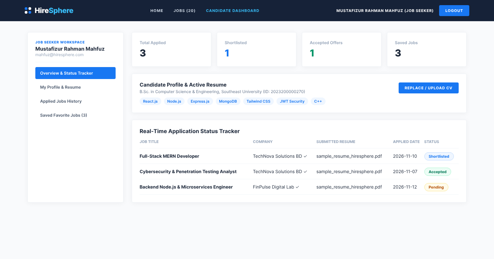
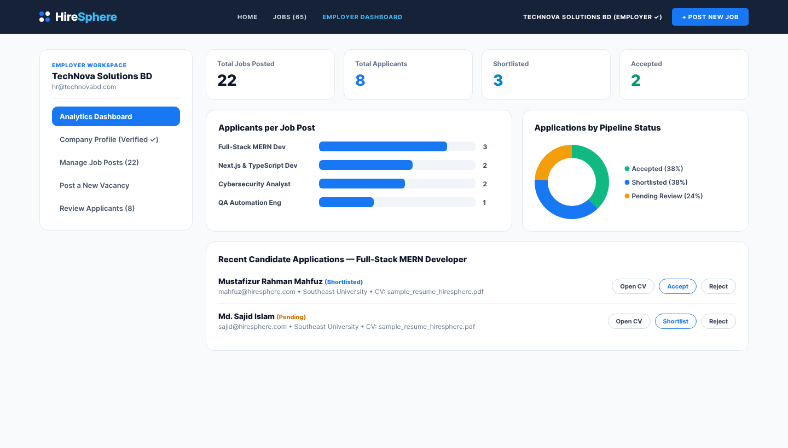
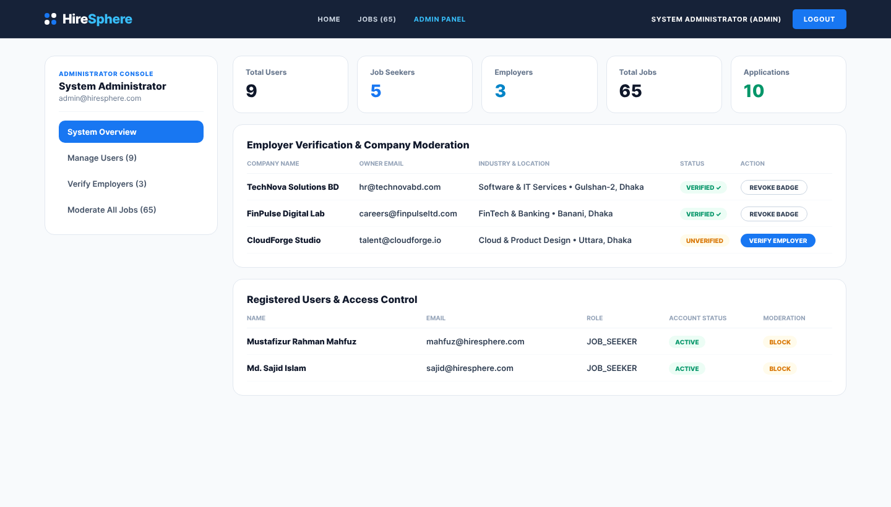

# HireSphere – Online Job Portal Management System

A full-stack **MERN (MongoDB, Express.js, React.js, Node.js)** web application connecting **Job Seekers**, **Employers**, and **System Administrators** on a centralized recruitment platform.

---


## Application Preview Screenshots

### 1. Home Page, Hero Search & Portrait Job Cards


### 2. Job Seeker Dashboard, Resume Upload & Status Tracker


### 3. Employer Recruitment Analytics & Applicant Pipeline


### 4. System Administrator Console & Employer Verification


---

## Monorepo Folder Structure

```text
hiresphere/
├── README.md
├── screenshots/                    # 4 UI preview screenshots for GitHub display
│   ├── 1-home-and-hero-search.png
│   ├── 2-job-seeker-dashboard.png
│   ├── 3-employer-analytics-dashboard.png
│   └── 4-admin-moderation-console.png
├── server/                         # Node.js + Express + MongoDB Backend API
│   ├── package.json
│   ├── .env.example
│   ├── uploads/                    # Static storage for resumes (PDF/DOCX) & company logos
│   └── src/
│       ├── server.js               # Express entry point (validates JWT_SECRET on startup)
│       ├── config/
│       │   └── db.js               # Mongoose connection helper
│       ├── models/
│       │   ├── User.js             # User schema (JOB_SEEKER, EMPLOYER, ADMIN) + bcrypt
│       │   ├── Profile.js          # Job Seeker profile & resumePath
│       │   ├── Company.js          # Employer company details & isVerified badge
│       │   ├── Job.js              # Job vacancy schema + text indexes
│       │   ├── Application.js      # Job application schema + unique (job, applicant) index
│       │   └── SavedJob.js         # Saved favorite jobs + unique (user, job) index
│       ├── middleware/
│       │   ├── auth.js             # JWT verification & role-based access control (RBAC)
│       │   ├── upload.js           # Multer file upload validation (5MB resume / 3MB logo)
│       │   ├── validate.js         # express-validator request validator
│       │   └── errorHandler.js     # Central error handling middleware
│       ├── controllers/
│       │   ├── authController.js
│       │   ├── profileController.js
│       │   ├── companyController.js
│       │   ├── jobController.js
│       │   ├── applicationController.js
│       │   ├── savedJobController.js
│       │   ├── employerController.js
│       │   └── adminController.js
│       ├── routes/
│       │   ├── authRoutes.js
│       │   ├── profileRoutes.js
│       │   ├── companyRoutes.js
│       │   ├── jobRoutes.js
│       │   ├── applicationRoutes.js
│       │   ├── savedJobRoutes.js
│       │   ├── employerRoutes.js
│       │   └── adminRoutes.js
│       ├── utils/
│       │   ├── asyncHandler.js
│       │   ├── apiResponse.js
│       │   └── escapeRegex.js      # Escapes special regex characters in search queries
│       └── seed/
│           └── seed.js             # Seeds 1 Admin, 3 Employers, 5 Seekers, 20 Jobs, 10 Applications
└── client/                         # React (Vite) + Tailwind CSS Frontend
    ├── package.json
    ├── .env.example
    ├── vite.config.js
    ├── tailwind.config.js
    ├── postcss.config.js
    ├── index.html
    ├── public/
    │   └── _redirects              # SPA routing rule for Netlify deployment
    └── src/
        ├── main.jsx
        ├── App.jsx
        ├── index.css
        ├── services/
        │   └── api.js              # Axios instance with JWT & 401 redirect interceptor
        ├── context/
        │   └── AuthContext.jsx     # Global authentication & role routing state
        ├── components/
        │   ├── Navbar.jsx
        │   ├── Footer.jsx
        │   ├── DashboardLayout.jsx
        │   ├── ProtectedRoute.jsx
        │   ├── JobCard.jsx
        │   ├── StatCard.jsx
        │   ├── StatusBadge.jsx
        │   ├── Modal.jsx
        │   ├── Pagination.jsx
        │   ├── Loader.jsx
        │   └── EmptyState.jsx
        └── pages/
            ├── public/             # Home, Jobs, JobDetails, Login, Register, NotFound
            ├── seeker/             # SeekerDashboard, SeekerProfile, SeekerApplications, SeekerSaved
            ├── employer/           # EmployerDashboard, EmployerCompany, EmployerJobs, EmployerJobForm, EmployerJobApplicants
            └── admin/              # AdminDashboard, AdminUsers, AdminEmployers, AdminJobs
```

---

## Local Setup & Installation Instructions

### Prerequisites
- **Node.js** (v18+ recommended)
- **MongoDB** running locally (`mongodb://127.0.0.1:27017/hiresphere`) or a **MongoDB Atlas** connection URI.

### Step 1: Configure & Start the Backend (`/server`)

1. Copy `.env.example` to `.env` inside `/server` and set `JWT_SECRET` (the server refuses to start if `JWT_SECRET` is missing):
```bash
cd server
cp .env.example .env
npm install
```

2. Open `server/.env` and set a strong secret value for `JWT_SECRET`:
```env
PORT=5000
NODE_ENV=development
MONGO_URI=mongodb://127.0.0.1:27017/hiresphere
JWT_SECRET=change_this_to_a_long_random_string
JWT_EXPIRES_IN=7d
CLIENT_URL=http://localhost:5173
```

3. Seed the database with sample data (1 Admin, 3 Employers, 5 Job Seekers, 20 Jobs, 10 Applications):
```bash
npm run seed
```

4. Start the Express development server with `nodemon`:
```bash
npm run dev
```
The API will be available at `http://localhost:5000/api`.

### Step 2: Configure & Start the Frontend (`/client`)

Open a second terminal:
```bash
cd client
cp .env.example .env
npm install
npm run dev
```

Open `http://localhost:5173` in your browser.

---

## Demo Login Credentials (Seeded via `npm run seed`)

| Role | Name / Organization | Email | Password |
| :--- | :--- | :--- | :--- |
| **ADMIN** | System Administrator | `admin@hiresphere.com` | `Admin@123` |
| **EMPLOYER (Verified)** | TechNova Solutions BD | `hr@technovabd.com` | `Employer@123` |
| **EMPLOYER (Verified)** | FinPulse Digital Lab | `careers@finpulseltd.com` | `Employer@123` |
| **EMPLOYER (Unverified)** | CloudForge Studio | `talent@cloudforge.io` | `Employer@123` |
| **JOB SEEKER 1** | Mustafizur Rahman Mahfuz | `mahfuz@hiresphere.com` | `Seeker@123` |
| **JOB SEEKER 2** | Md. Sajid Islam | `sajid@hiresphere.com` | `Seeker@123` |
| **JOB SEEKER 3** | Farhana Yasmin | `farhana@hiresphere.com` | `Seeker@123` |

---

## Complete REST API Overview

All endpoints return a consistent JSON envelope:
```json
{
  "success": true,
  "message": "Descriptive message",
  "data": {}
}
```

| Category | Method | Endpoint | Access | Description |
| :--- | :--- | :--- | :--- | :--- |
| **Auth** | `POST` | `/api/auth/register` | Public | Register a new Job Seeker or Employer |
| **Auth** | `POST` | `/api/auth/login` | Public | Authenticate user and receive JWT |
| **Auth** | `GET` | `/api/auth/me` | Protected | Get logged-in user and profile/company |
| **Profile** | `GET` | `/api/profile` | `JOB_SEEKER` | Get job seeker profile |
| **Profile** | `PUT` | `/api/profile` | `JOB_SEEKER` | Update profile fields and skill tags |
| **Profile** | `POST` | `/api/profile/resume` | `JOB_SEEKER` | Upload/replace PDF/DOC/DOCX resume (max 5 MB) |
| **Profile** | `DELETE` | `/api/profile/resume` | `JOB_SEEKER` | Delete uploaded resume |
| **Company** | `GET` | `/api/company` | `EMPLOYER` | Get employer's company profile |
| **Company** | `PUT` | `/api/company` | `EMPLOYER` | Create or update company details |
| **Company** | `POST` | `/api/company/logo` | `EMPLOYER` | Upload company logo image |
| **Jobs** | `GET` | `/api/jobs` | Public | Search, filter (`keyword`, `category`, `location`, `jobType`), and paginate (`page`, `limit`) |
| **Jobs** | `GET` | `/api/jobs/:id` | Public | Get detailed job info + company info |
| **Jobs** | `GET` | `/api/jobs/mine/list` | `EMPLOYER` | List all jobs posted by logged-in employer |
| **Jobs** | `POST` | `/api/jobs` | `EMPLOYER` | Post a new job opening |
| **Jobs** | `PUT` | `/api/jobs/:id` | `EMPLOYER` | Update employer's own job post |
| **Jobs** | `DELETE` | `/api/jobs/:id` | `EMPLOYER` | Delete employer's own job post |
| **Applications** | `POST` | `/api/jobs/:id/apply` | `JOB_SEEKER` | 1-click apply using saved profile & resume |
| **Applications** | `GET` | `/api/applications/mine` | `JOB_SEEKER` | List all jobs applied to by current seeker |
| **Applications** | `GET` | `/api/jobs/:id/applications` | `EMPLOYER` | List applicants, profiles, and CVs for a job |
| **Applications** | `PATCH` | `/api/applications/:id/status` | `EMPLOYER` | Update status (`Pending`, `Shortlisted`, `Accepted`, `Rejected`) |
| **Saved Jobs** | `GET` | `/api/saved` | `JOB_SEEKER` | List saved favorite jobs |
| **Saved Jobs** | `POST` | `/api/saved/:jobId` | `JOB_SEEKER` | Bookmark a job |
| **Saved Jobs** | `DELETE` | `/api/saved/:jobId` | `JOB_SEEKER` | Remove a bookmarked job |
| **Employer Stats** | `GET` | `/api/employer/stats` | `EMPLOYER` | Stat cards + applicants per job & status pie chart data |
| **Admin** | `GET` | `/api/admin/stats` | `ADMIN` | Platform totals + monthly growth & category chart data |
| **Admin** | `GET` | `/api/admin/users` | `ADMIN` | List & search users by keyword and role |
| **Admin** | `PATCH` | `/api/admin/users/:id/block` | `ADMIN` | Block or unblock user account |
| **Admin** | `DELETE` | `/api/admin/users/:id` | `ADMIN` | Delete user account and cascade records |
| **Admin** | `PATCH` | `/api/admin/employers/:id/verify` | `ADMIN` | Verify or unverify employer company |
| **Admin** | `GET` | `/api/admin/jobs` | `ADMIN` | List all job posts for moderation |
| **Admin** | `DELETE` | `/api/admin/jobs/:id` | `ADMIN` | Remove inappropriate or fraudulent job post |


## 🌐 Live Demo

[](https://hiresphere-job-portal.netlify.app/)
